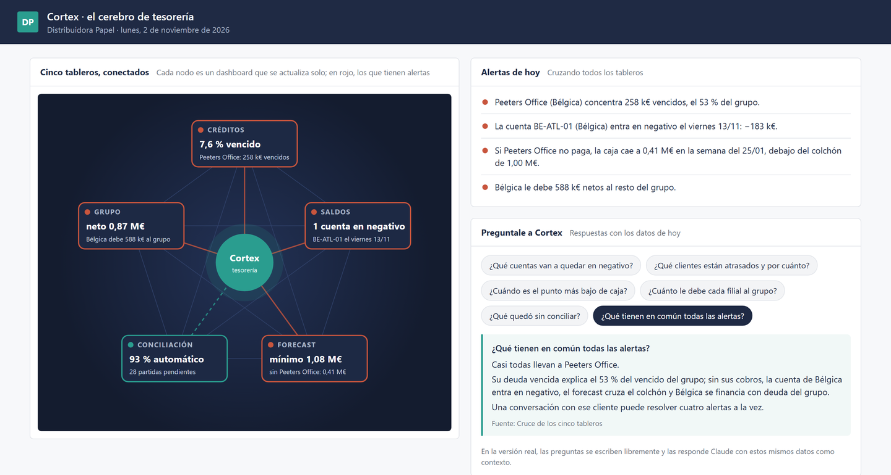

# Cortex: un cerebro para tesorería

Cada dashboard de tesorería resuelve una pregunta: cuánto hay en los bancos, quién está atrasado, cómo viene la caja, qué falta conciliar. Pero las respuestas importantes suelen estar en el cruce, y cruzar cinco tableros a mano es justo lo que nadie tiene tiempo de hacer.

Cortex no recalcula nada: **lee lo que ya generan las otras demos y las conecta**.

```
python armar_cerebro.py
```

Genera `Cortex.html` con:

- **la red de tableros**: créditos, saldos, forecast, conciliación y deuda del grupo, cada uno con su dato clave y en rojo si tiene alertas;
- **alertas de hoy**, cruzando todas las fuentes;
- **"Preguntale a Cortex"**: preguntas típicas respondidas con los datos del día y con la fuente de cada respuesta.

> En la versión real, las preguntas se escriben libremente y las responde Claude, usando estos mismos datos como contexto. Acá las respuestas están armadas con reglas, para que la demo funcione sin claves ni conexión.
>
> Es una versión de demostración de un proyecto real. El código está reescrito desde cero y **todos los datos son ficticios**.



## Qué cuenta el ejemplo

Las alertas parecen independientes: un cliente con mucho vencido, una cuenta de Bélgica que va a quedar en negativo, un forecast que cruza el colchón, una filial endeudada con el grupo. Cortex muestra que **casi todas llevan al mismo lugar: Peeters Office**. Una conversación con ese cliente puede resolver cuatro alertas a la vez.

## Correrlo

Primero, las demos que alimentan a Cortex (en este orden):

```
python ../informe-mensual/informe.py
python ../saldos-tesoreria/armar_dashboard.py
python ../forecast-caja/forecast.py
python ../conciliacion/conciliar.py
python ../grupo-neto/neteo.py
python armar_cerebro.py
```

---

Hecho por Matías Banak · [Deyta Analytics](https://deyta-web.web.app)
