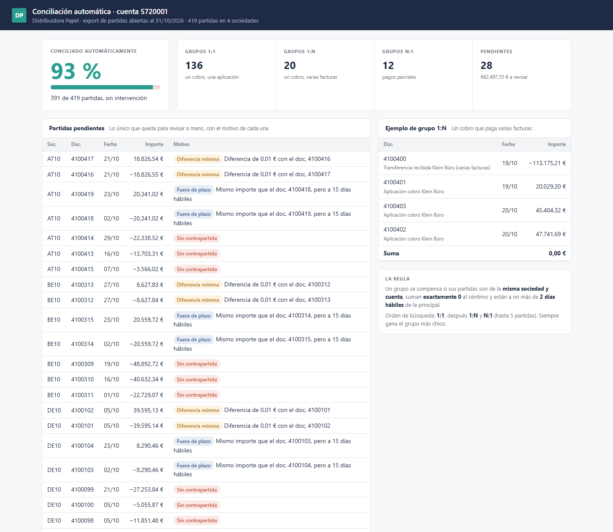

# Conciliación automática de partidas

Las cuentas puente (cobros pendientes de aplicar, transitorias, intercompany) acumulan cientos de partidas abiertas que hay que emparejar a mano: este cobro con esta factura, estos dos pagos parciales con esta aplicación... Es trabajo de lupa, y cuando algo no cuadra no queda claro por qué.

Este proyecto concilia el export de partidas abiertas en segundos y **explica cada partida que queda pendiente**:

```
python conciliar.py
```

Genera `salida/conciliacion.xlsx` (hoja *Conciliadas* con el número de grupo y su tipo, hoja *Pendientes* con el motivo) y `salida/informe.html`.

> Es una versión de demostración de una herramienta que armé en un entorno real. El código está reescrito desde cero y **todos los datos son ficticios**.



## La regla

Un grupo se compensa si sus partidas:

- son de la **misma sociedad y cuenta**;
- suman **exactamente 0**, al céntimo;
- están a no más de **2 días hábiles** de la partida principal (la de mayor importe).

La búsqueda va de lo simple a lo complejo y siempre prefiere el grupo más chico:

1. **1:1**: un cobro y su aplicación.
2. **1:N**: un cobro que paga varias facturas (búsqueda de subconjuntos que suman exacto, con un límite de nodos para que nunca se cuelgue).
3. **N:1**: varios pagos parciales para una sola aplicación.

## Lo que queda pendiente, y por qué

| Motivo | Qué suele ser |
|---|---|
| **Diferencia mínima** | Una comisión o un redondeo de 0,01 € que impide el cuadre exacto |
| **Fuera de plazo** | Existe la contrapartida exacta, pero se registró semanas después |
| **Sin contrapartida** | Un cobro sin identificar: hay que averiguar de quién es |

En el ejemplo, 391 de 419 partidas (93 %) se concilian solas. Las 28 restantes llegan con su diagnóstico.

## Opciones

```
python conciliar.py --tol 5          # más días de tolerancia
python conciliar.py --max-grupo 6    # grupos más grandes
```

Requisitos: Python 3.10+ con `pandas`, `numpy` y `openpyxl`.

---

Hecho por Matías Banak · [Deyta Analytics](https://deyta-web.web.app)
