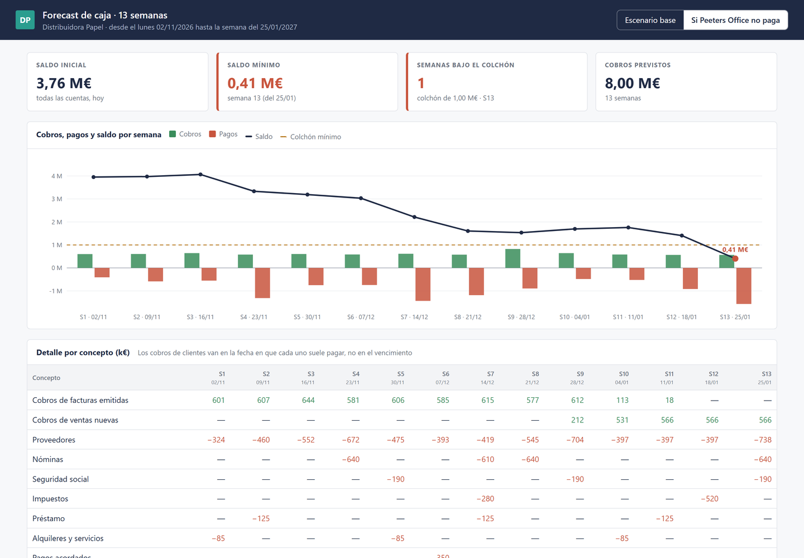

# Forecast de caja a 13 semanas

Saber cuánta plata hay hoy es fácil. Lo difícil es saber cuánta va a haber dentro de dos meses, cuando coinciden las nóminas, el IVA del trimestre y un cliente grande que paga tarde.

Este proyecto arma el forecast de caja semana a semana, cruzando todo lo que se espera cobrar y pagar:

```
python forecast.py
```

Genera `Forecast_13_semanas.html`, con dos escenarios que se cambian con un clic: el base y "¿qué pasa si este cliente no paga?".

> Es una versión de demostración de un modelo que armé en un entorno real. El código está reescrito desde cero y **todos los datos son ficticios**.



## De dónde sale cada línea

| Línea | Fuente | Fecha de caja |
|---|---|---|
| Saldo inicial | Saldos bancarios del día ([saldos-tesoreria](../saldos-tesoreria)) | Hoy |
| Cobros de facturas emitidas | Facturas abiertas de clientes ([informe-mensual](../informe-mensual)) | **Vencimiento + atraso histórico de cada cliente** |
| Cobros de ventas nuevas | Ventas presupuestadas, repartidas por cliente | Emisión + 60 días + atraso histórico |
| Proveedores | Ageing de proveedores + compras futuras (62 % de las ventas) | Vencimiento |
| Nóminas, cargas sociales, impuestos, préstamo, alquileres, pagos acordados | Compromisos fijos | Fecha del compromiso |

La clave está en la segunda fila: un cobro no entra cuando vence, entra cuando el cliente suele pagar. Peeters Office paga con 55 días de atraso, y el forecast lo sabe.

## Qué cuenta el ejemplo

En el escenario base la caja baja de 3,8 M€ a 1,1 M€ en enero, pero nunca cruza el colchón de 1 M€. Si Peeters Office no paga, la última semana de enero (nóminas, cargas sociales y proveedores juntos) **queda en 0,41 M€**, por debajo del colchón. Con 12 semanas de anticipación hay tiempo de negociar una línea de crédito o reprogramar un pago.

## Correrlo

Requiere haber corrido antes `informe-mensual/generar_datos.py` y, si se quiere el saldo real del día, `saldos-tesoreria/armar_dashboard.py`.

```
pip install pandas openpyxl
python forecast.py
```

---

Hecho por Matías Banak · [Deyta Analytics](https://deyta-web.web.app)
