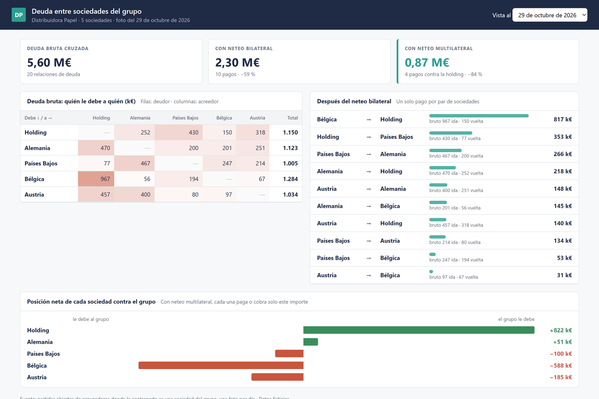

# Deuda entre sociedades del grupo

En un grupo con varias sociedades, todas se deben algo entre sí: servicios de gestión, compras de mercadería, cash pooling... Si cada deuda se paga por separado, la plata da vueltas en círculos: Alemania le paga a Países Bajos y Países Bajos le paga a Alemania la misma semana.

Este proyecto toma el export de partidas abiertas entre sociedades y calcula cuánto queda si se netea:

```
python neteo.py
```

Genera `Grupo_neto.html` con:

- la **matriz bruta** de quién le debe a quién;
- el **neteo bilateral**: un solo pago por par de sociedades, en la dirección que corresponde;
- la **posición neta** de cada sociedad contra el grupo (neteo multilateral: cada una paga o cobra solo su saldo, contra la holding);
- un selector **"Vista al"**: cada export diario queda como una foto, para ver cómo evoluciona.

> Es una versión de demostración de una herramienta que armé en un entorno real. El código está reescrito desde cero y **todos los datos son ficticios**.



## Detalles que importan

- **Contrapartes por nombre.** En el export, el acreedor viene como texto ("Nombre 1"), no como código. Se mapea a la sociedad y lo que no se reconoce se avisa por consola en vez de perderse en silencio.
- **Una sociedad contra sí misma no se netea.** A veces aparece por motivos contables internos; se excluye.
- **Las fotos viejas no se borran.** Cada archivo `intercompany_AAAA-MM-DD.xlsx` es un día del histórico.

## Qué cuenta el ejemplo

5,6 M€ de deuda cruzada en 20 relaciones se reducen a 2,3 M€ en 10 pagos con neteo bilateral, y a 0,87 M€ con neteo multilateral (−84 %). Bélgica es la que más le debe al grupo: la misma filial que en el [forecast](../forecast-caja) y en los [saldos](../saldos-tesoreria) aparece con la caja corta.

## Correrlo

```
pip install pandas openpyxl
python neteo.py
```

---

Hecho por Matías Banak · [Deyta Analytics](https://deyta-web.web.app)
