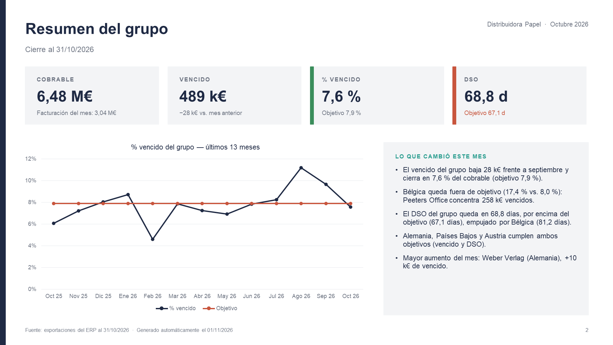
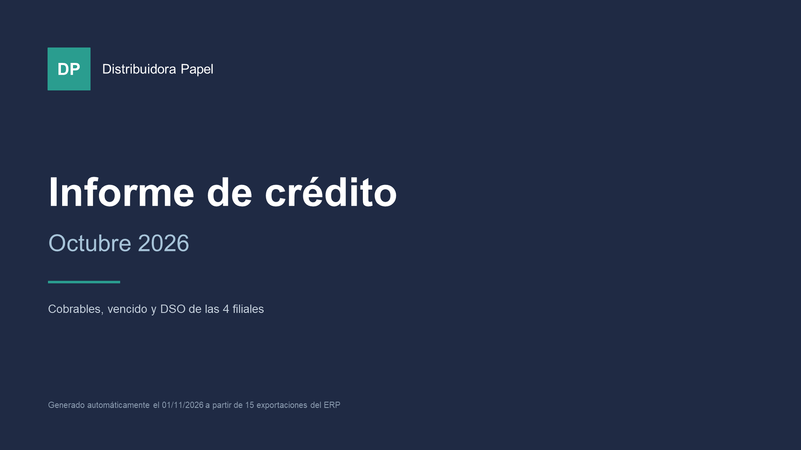
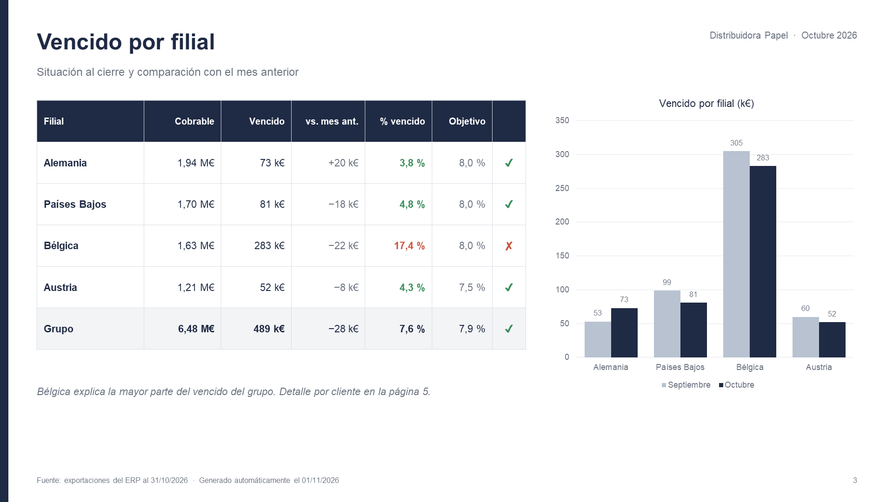
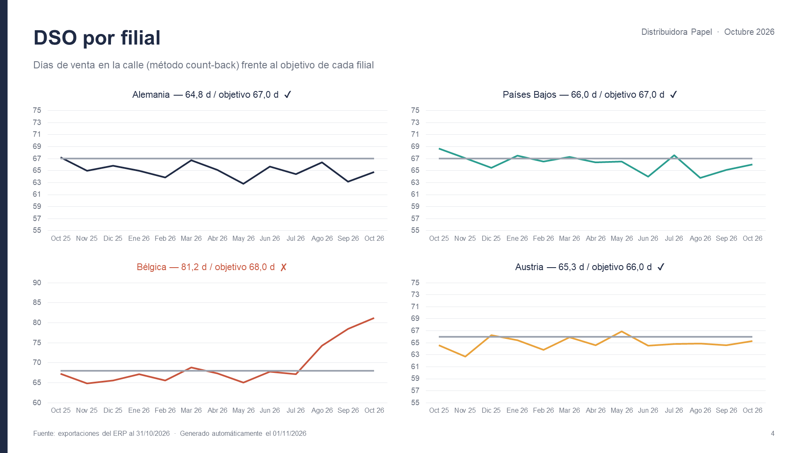
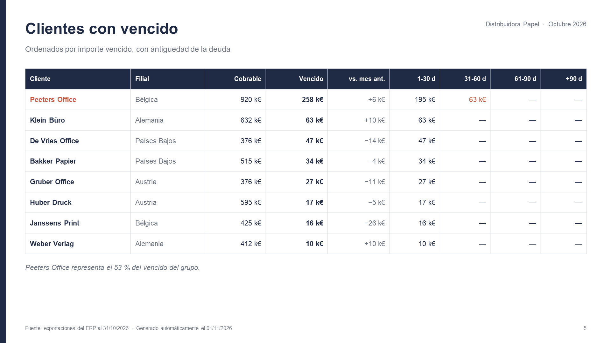

# Informe mensual automático: del export del ERP al PowerPoint

Todos los meses, el área de finanzas presenta el mismo informe de crédito: cuánto se tiene por cobrar, cuánto está vencido, cuántos días tardan los clientes en pagar (DSO) y quién explica los desvíos. Armarlo a mano lleva días: bajar exportaciones, pegarlas en Excel, actualizar gráficos, copiarlos al PowerPoint, escribir los comentarios.

Este proyecto hace todo eso con un comando:

```
python informe.py
```

Y en unos segundos aparece el PowerPoint del mes, con gráficos editables y **las notas del mes escritas a partir de los números**.

> Es una versión de demostración de un sistema que armé en un entorno real. El código está reescrito desde cero y **todos los datos son ficticios**: "Distribuidora Papel" no existe, y sus filiales y clientes tampoco.



## Cómo funciona

```
 datos/  (exportaciones del ERP)            calcular.py              generar_informe.js         exportar_png.ps1
 ├─ facturacion.xlsx              ──►  métricas por filial,  ──►  PowerPoint del mes   ──►  una imagen por
 ├─ cobrables_AAAA-MM.xlsx (x mes)     DSO, antigüedad,            (pptxgenjs, gráficos     slide (opcional)
 └─ objetivos.xlsx                     notas automáticas           nativos y editables)
                                       → metricas.json
```

1. **Exportaciones.** Cada cierre de mes, el ERP entrega las partidas abiertas de clientes (`cobrables_AAAA-MM.xlsx`) y la facturación. Acá las genera `generar_datos.py` con una semilla fija.
2. **Cálculo** (`calcular.py`, pandas). Para los últimos 13 meses y cada filial: cobrable, vencido, % vencido, DSO por *count-back* y antigüedad de la deuda por cliente (1-30, 31-60, 61-90, +90 días).
3. **Notas del mes.** Las frases de "Lo que cambió este mes" no las escribe nadie: salen de comparar cada filial contra su objetivo y contra el mes anterior.
4. **PowerPoint** (`generar_informe.js`, pptxgenjs). Cinco slides con el estilo de la empresa: portada, resumen, vencido por filial, DSO por filial y clientes.
5. **Imágenes** (`exportar_png.ps1`). Usa PowerPoint para exportar cada slide a PNG, útil para mandar por mail o chat.

## Qué cuenta el informe de ejemplo

En octubre de 2026 el grupo cumple el objetivo de vencido, pero **Bélgica no**: un solo cliente, Peeters Office, empezó a pagar cada vez más tarde desde el verano y hoy concentra la mitad del vencido del grupo. El informe lo detecta solo: lo marca en rojo, lo menciona en las notas y muestra cómo el DSO de Bélgica se despega del objetivo mes a mes.

| | |
|---|---|
|  |  |
|  |  |

## Correrlo

Requisitos: Python 3.10+ con `pandas` y `openpyxl`, y Node 18+.

```
pip install pandas openpyxl
npm install
python informe.py            # último mes disponible
python informe.py 2026-08    # o un mes en particular
```

La exportación a PNG necesita Windows con PowerPoint instalado. Sin eso, el `.pptx` se genera igual.

## Por qué así

- **Python para los números, JavaScript para el PowerPoint.** pandas es lo más cómodo para cruzar exportaciones; pptxgenjs genera gráficos nativos de PowerPoint (no imágenes), así quien recibe el informe puede editarlo.
- **Un JSON en el medio.** `metricas.json` separa el cálculo de la presentación: se puede cambiar el diseño sin tocar la lógica, o usar los mismos números para un dashboard.
- **Nada a mano.** Si un mes hay que corregir algo, se corrige en el script, no en el PowerPoint, y el mes siguiente ya sale bien.

---

Hecho por Matías Banak · [Deyta Analytics](https://deyta-web.web.app)
