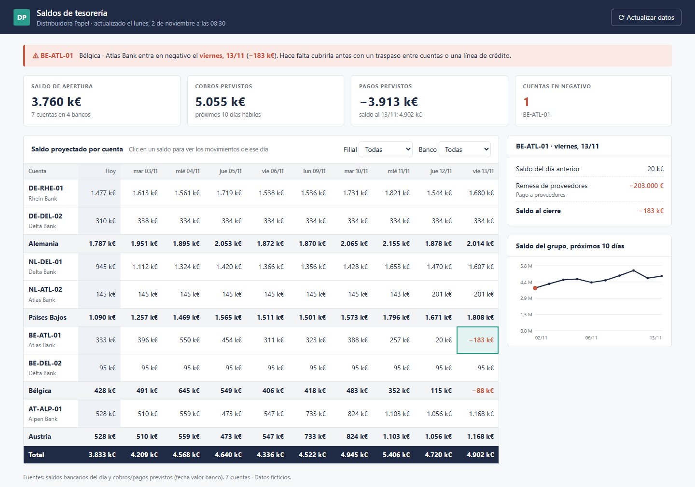

# Saldos de tesorería al día

Cada mañana, tesorería necesita saber cuánta plata hay en cada banco y si alguna cuenta se va a quedar corta en los próximos días. Lo habitual es entrar banco por banco, copiar saldos a un Excel y sumarle a mano los cobros y pagos previstos.

Este proyecto lo resuelve con un dashboard que se arma solo a partir de los ficheros del día:

```
python armar_dashboard.py
```

Genera `Saldos_tesoreria.html`, un único archivo que se abre con doble clic (no necesita servidor ni internet) y muestra:

- el saldo de cada cuenta proyectado día a día, los próximos 10 días hábiles;
- **una alerta cuando una cuenta va a entrar en negativo**, con la fecha y el importe;
- el detalle de cobros y pagos de cualquier día, con un clic en el saldo;
- filtros por filial y banco, subtotales por filial y el saldo del grupo.

> Es una versión de demostración de un sistema que armé en un entorno real. El código está reescrito desde cero y **todos los datos son ficticios**: "Distribuidora Papel", sus bancos y sus clientes no existen.



## Cómo funciona

```
 datos/saldos_hoy.csv              ─┐
                                    ├─►  armar_dashboard.py  ─►  Saldos_tesoreria.html
 datos/movimientos_previstos.xlsx  ─┘    (proyección por        (plantilla.html + datos
                                          cuenta y alertas)       embebidos, sin servidor)
```

1. **Ficheros del día.** El saldo de apertura de cada cuenta y la lista de cobros y pagos previstos con su fecha valor. Acá los inventa `generar_datos.py` (se corre solo la primera vez).
2. **Proyección.** Para cada cuenta, el saldo de cada día es el del día anterior más los movimientos previstos. Si en algún día queda por debajo de cero, se genera una alerta.
3. **Dashboard.** Los datos se embeben en `plantilla.html` y sale un HTML autocontenido, fácil de mandar por mail o dejar en una carpeta compartida.

## Qué cuenta el ejemplo

Un cliente de Bélgica, Peeters Office, dejó de pagar (es el mismo que aparece en el [informe mensual](../informe-mensual)). Sin sus cobros, la cuenta principal de Bélgica no alcanza a cubrir las nóminas y los pagos a proveedores: **entra en negativo el viernes 13/11**. El dashboard lo avisa con 9 días de margen, cuando todavía hay tiempo de mover fondos desde otra filial.

## Correrlo

Requisitos: Python 3.10+ con `pandas` y `openpyxl`.

```
pip install pandas openpyxl
python armar_dashboard.py
```

---

Hecho por Matías Banak · [Deyta Analytics](https://deyta-web.web.app)
